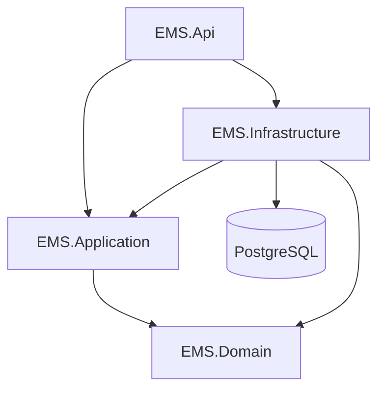

# Backend Architecture

The backend uses a layered design with dependencies pointing inward.

## Dependency Direction

`EMS.Domain` has no project dependency. It owns entities such as `Employee`, `Department`, `AttendanceLog`, and `LeaveRequest`.

`EMS.Application` depends on Domain and defines use cases, DTOs, validators, and abstractions such as `IEmployeeRepository`, `IPasswordHasher`, `ITokenService`, `ICurrentUser`, and `IAttendancePolicy`.

`EMS.Infrastructure` implements persistence and external concerns: EF Core repositories, PostgreSQL configuration, migrations, BCrypt password hashing, JWT generation, and seed data.

`EMS.Api` exposes HTTP endpoints. Controllers depend on application service interfaces and keep HTTP concerns separate from business rules.

## Domain Model

`BaseEntity` and `AuditableEntity` are abstract classes because domain entities share state and timestamp behavior. `Employee`, `Department`, `AttendanceLog`, and `LeaveRequest` inherit from `AuditableEntity`.

Entities protect key state changes through methods such as `Employee.AssignManager()`, `Employee.Deactivate()`, `AttendanceLog.CheckOut()`, `LeaveRequest.Approve()`, and `LeaveRequest.Reject()`.

## Application Boundary

Application services coordinate workflows:

- `AuthService` authenticates users through `IEmployeeRepository`, `IPasswordHasher`, and `ITokenService`.
- `AttendanceService` uses `ICurrentUser`, repositories, and `IAttendancePolicy`.
- `LeaveService` enforces requester ownership and manager-subordinate authorization.

The Application project does not depend on EF Core, BCrypt, ASP.NET `HttpContext`, Npgsql, or JWT implementation classes.

## Infrastructure Boundary

Repositories translate application queries into EF Core queries. Filtering, sorting, counting, and pagination happen before materialization.

Database constraints enforce uniqueness and relational integrity. A partial PostgreSQL unique index prevents more than one active attendance record per employee where `CheckOutTime` is null.

## Validation and Errors

FluentValidation handles request shape and input rules. Application services enforce cross-entity workflow rules. Domain entities enforce invariants. PostgreSQL enforces data integrity.

The API uses centralized exception handling and ProblemDetails responses.
